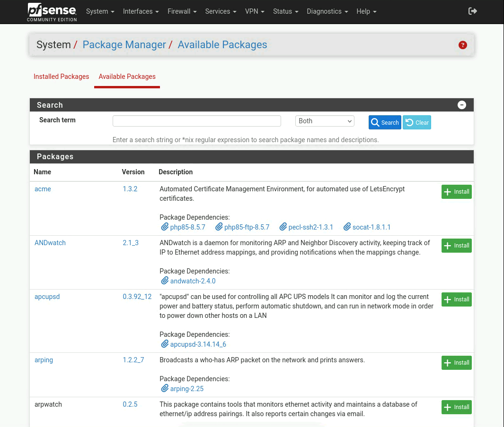
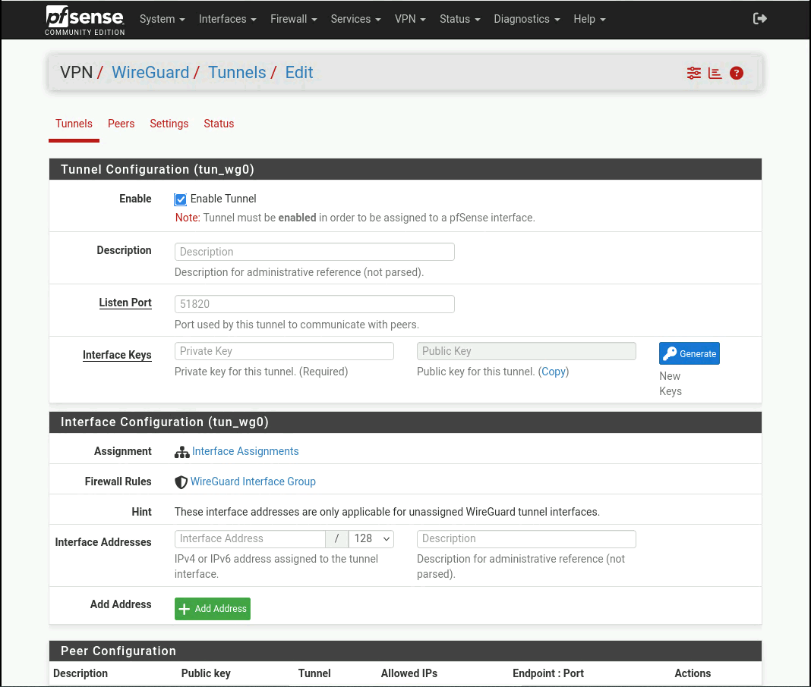
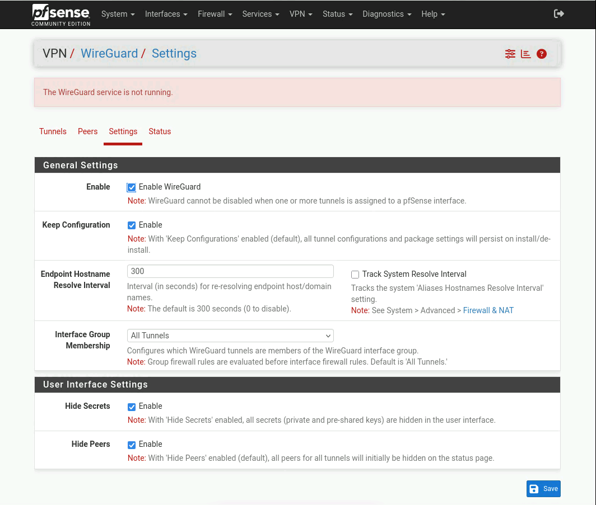
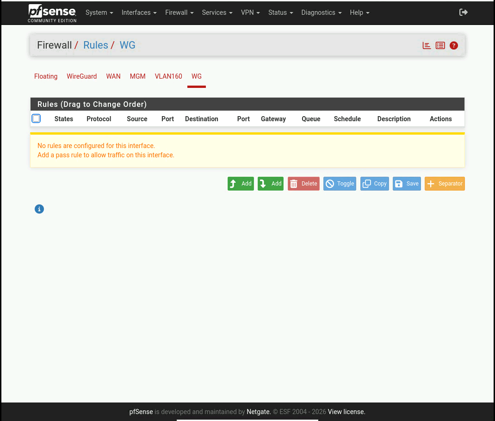
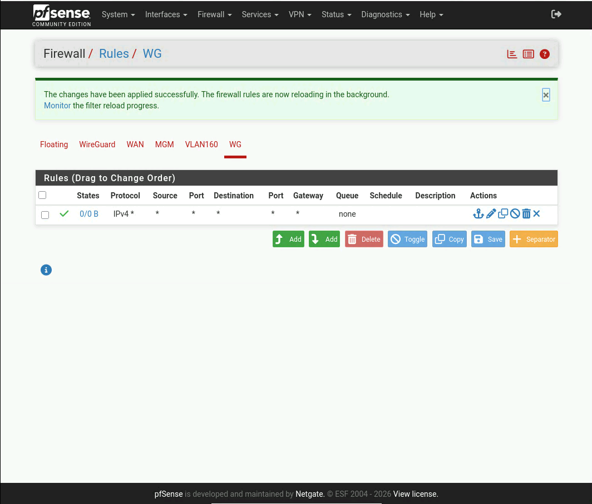

# installation de WireGuard

ici je vais installer wireguard sur le jump server pour pouvoir y accèder depuis cher moi
j'ai choisi wireguard car il est asser simple a utiliser rapide et est très sécuriser.

pour commencer allon dans System -> Package Manager -> Available Packages.

et chercher wireguard et installer le puis aller dans Vpn -> WireGuard
puis cliquer sur le + Add Tunnel en bas a droite.

vous devriez avoir ceci: 

1. donnez une description ici j'ai choisi : WG
2. ajouter un port pour écouter ici j'ai garder par défaut : 51820
3. pour interface Keys cliquez sur : Generate et copiez la  clé publique
4. cliquez sur sauvgardez le tunnel.

il faut maintenant lui configurez une interface ici je vais utilisez MGM qui me permet d'accédez a mon jump server enfait je suis obligez de crée une nouvelle interface je vais donc la crée et elle ne pourras accédez que a l'interface MGM et seulement a jump server

allez dans settings et cochez la case Enable WireGuard : 
save et apply

puis retournez dans tunnels et cliquez sur le crayon pour editez le tunnels et ajoutez une nouvelle interface OPT3 allez dans OPT3 et enable l'interface 
save et apply
j'ai modifiez le nom pour WG

!!! REVOIR ICI PROBLEME AVEC LES CONSIGNE ET AJOUTEZ SCREEN SHOOT !!!

maintenant allons dans les règles de firewall pour ajouter une règle allow all pour commencer et tester si cela fonctionne(par apprès on va restrindre au jump server).

allez dans Firewall -> Rules -> WG
cliquez sur Add 

vous devriez avoir ceci : 

maintenant nous allons ajoutez une règle pour laissez passer le trafique de la wan vers notre intreface vpn.

https://www.delixirpro.com/blog/2024/08/21/creer-une-connexion-vpn-site-a-site-avec-wireguard-sous-pfsense/
